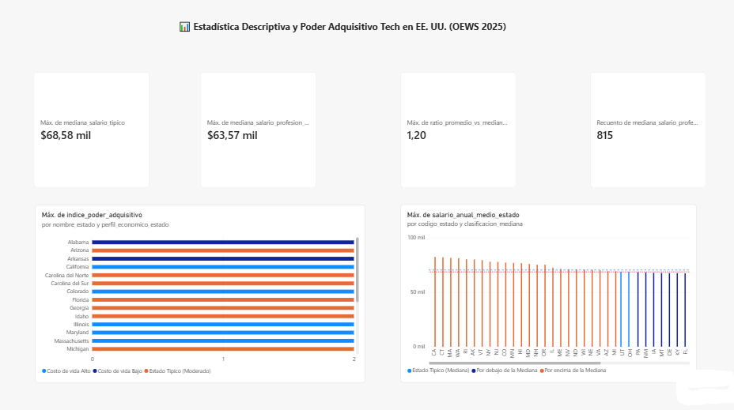

markdown
# 📊 Estadística Descriptiva y Poder Adquisitivo: Análisis Salarial en EE. UU. (OEWS 2025)

🔗 **Origen de los datos:** Este análisis estadístico consume las tablas curadas (`tb_slv_oews_clean`, `tb_gld_state_summary` y `tb_gld_tech_salaries`) generadas en el pipeline de ingeniería del repositorio **[Gobierno de Datos y Arquitectura Medallion: Análisis del Mercado Laboral (OEWS 2025)](https://github.com)**.

---

## 🎯 1. Objetivo del Proyecto
Brindar métricas salariales limpias, dinámicas y comparables para que un profesional especializado (p. ej., cirujano o ingeniero de software) identifique los estados de EE. UU. con la mejor relación costo/beneficio y calidad de vida, evitando las distorsiones de los promedios tradicionales.

---

## ❓ 2. Preguntas de Negocio Resueltas

1. **¿Qué es un "Estado Típico"?**
   Es el estado ubicado exactamente en la mediana económica del país (\$68,575.01), evitando los extremos de mercados saturados como California/Nueva York o economías de bajo ingreso como Misisipi.
2. **¿Qué es una "Profesión Típica"?**
   Es la ocupación situada en el centro de las 815 categorías laborales analizadas (\$63,566.00), donde el 50 % de las profesiones percibe menos y el 50 % percibe más.
3. **¿Dónde rinde más el dinero en tecnología?**
   En estados con costo de vida bajo o moderado (como Oregón, Carolina del Norte, Texas o Georgia), donde el salario promedio ponderado tecnológico supera entre **1.5x y 1.7x** el ingreso promedio local.

---

## 🛡️ 3. Reglas de Calidad de Datos (Exclusión de Outliers)
Para garantizar comparaciones estadísticamente válidas entre los 50 estados oficiales de EE. UU., se excluyeron dos jurisdicciones atípicas:
* **Distrito de Columbia (`DC`):** Excluido por ser un distrito 100 % urbano y sede federal sin zonas rurales que equilibren su salario medio (\$86,071.35), lo cual infla artificialmente los promedios nacionales.
* **Puerto Rico (`PR`):** Excluido por ser un territorio no incorporado con una estructura salarial distinta (\$43,882.65, casi \$10,000 por debajo del estado con menor ingreso en EE. UU.).

---

## 📈 4. Hallazgos Estadísticos (Corte OEWS 2025)

| Dimensión Analizada | Mediana (Típica) | Promedio Nacional | Ratio (Media / Mediana) | Diagnóstico Estadístico |
| :--- | :---: | :---: | :---: | :--- |
| **Salarios por Estado (50 estados)** | **\$68,575.01** | \$70,442.27 | **1.03x** | Sesgo positivo leve (+3 %); diferencias moderadas entre estados. |
| **Salarios por Ocupación (815 roles)** | **\$63,566.00** | \$76,321.55 | **1.20x** | Fuerte sesgo positivo (+20 %) impulsado por profesiones de élite. |

---

## 📊 5. Visualización Ejecutiva en Power BI (Microsoft Fabric)
El modelo estrella construido sobre las tablas Gold y la tabla dimensional `tb_dim_estados` permite explorar el ranking de poder adquisitivo tecnológico y la asimetría salarial estatal:



---

## 🗂️ 6. Estructura del Repositorio

```text
oews-estadistica-descriptiva-salarios/
├── images/
│   └── dashboard_powerbi_oews_2025.png       # Captura del informe ejecutivo en Power BI / Fabric
├── sql/
│   └── qy_analisis_sesgo_salarial_eeuu.sql   # Script analítico en Databricks SQL (Capa Gold y Dimensión)
└── README.md                                 # Documentación técnica y hallazgos de negocio
```

---

## 🛠️ 7. Stack Tecnológico
* **Databricks SQL & Delta Lake:** Cálculo dinámico de percentiles (`PERCENTILE_CONT`), funciones de ventana (`ROW_NUMBER`), promedios ponderados por volumen de empleo y control de división por cero (`NULLIF`).
* **Microsoft Fabric / Power BI:** Modelado dimensional en estrella y visualización de métricas KPI, distribución salarial y rankings.
* **Git & GitHub:** Control de versiones y documentación técnica.